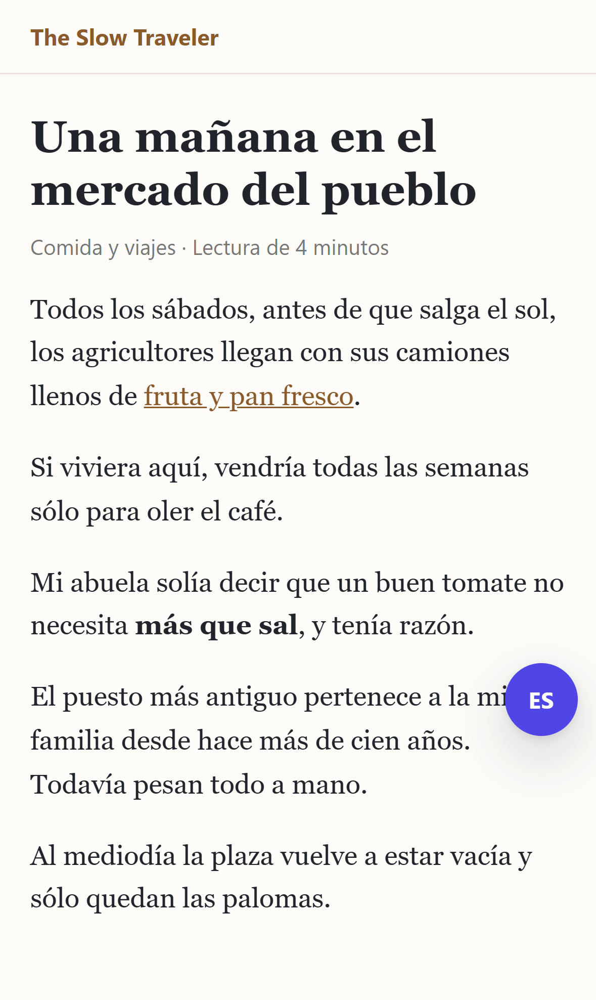
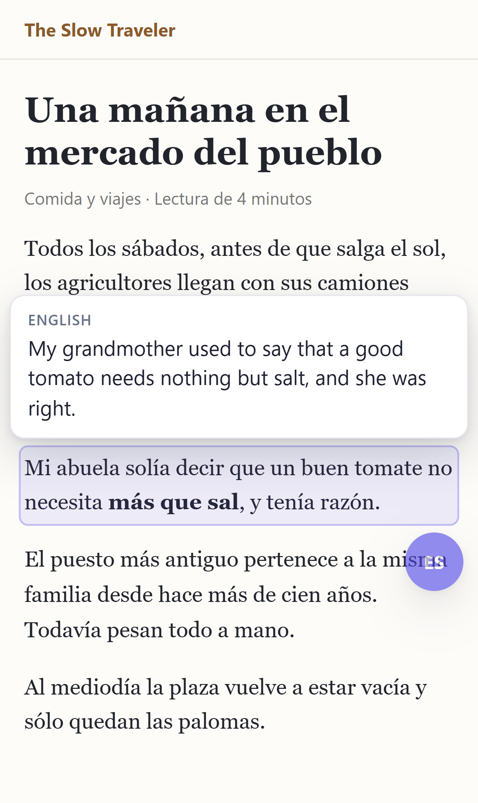
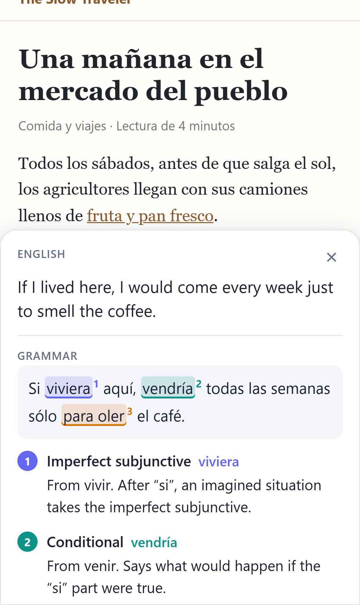
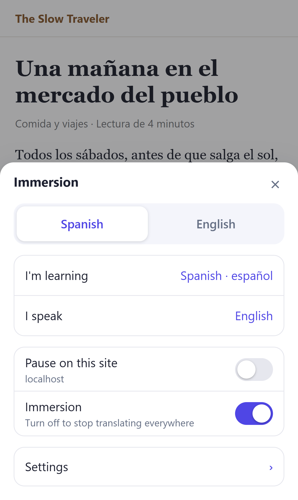

<div align="center">


# Immersion for iPhone

**Learn a language while you scroll.**

Read the web in the language you're learning, peek at your own language whenever you need it,<br />
and get grammar tips on any sentence. Runs in Safari.


<table>
  <tr>
    <td align="center"><br /><sub>Read</sub></td>
    <td align="center"><br /><sub>Peek</sub></td>
    <td align="center"><br /><sub>Grammar tips (example)</sub></td>
    <td align="center"><br /><sub>Menu</sub></td>
  </tr>
</table>

</div>

The phone version of the [Immersion browser extension](https://github.com/antoinenotnick/immersion).

## Features

**🌍 Passive immersion.** Websites appear in the language you're learning, translated in place as you scroll. Sites keep their layout and keep working.

**🔁 One-tap switching.** A floating button flips the page between your two languages instantly, with no extra requests. Your choice carries to the next page.

**👀 Peek.** Rest two fingers on a paragraph to see it in your own language, then lift and keep reading.

**✨ Grammar tips.** Select any text for its translation, then get an AI explanation of the grammar it uses, with key vocabulary.

**🤖 Your choice of AI.** Google Gemini, Groq or OpenRouter (all with free options), OpenAI or Anthropic Claude.

## Using it

| Do this | To |
| --- | --- |
| Scroll | Read pages in the language you're learning |
| Tap the round button | Switch the page between your two languages |
| Hold the button | Open the menu: languages, pause this site, settings |
| Drag the button | Move it out of the way |
| Rest two fingers on a paragraph | Peek at it in your other language |
| Select text | See its translation, then tap **Grammar tips** |

## Install

1. **Get the free [Userscripts app](https://apps.apple.com/app/userscripts/id1463298887)** and open it once.
2. **Turn it on** in Settings → Apps → Safari → Extensions → Userscripts (iOS 17 and earlier: Settings → Safari → Extensions). Set **All Websites** to **Allow**; translations can't be fetched without it.
3. **Add the script**, either way:
   - **As a file:** download [`dist/immersion.user.js`](dist/immersion.user.js) and, in the Files app, move it to **On My iPhone → Userscripts** (or the folder you picked in the app).
   - **Over Wi-Fi from a computer:** run `npm install` and `npm run serve` in this folder and open the address it prints in Safari. Then tap the extensions button in the address bar → **Userscripts** → install.
4. **Open any website** and pick your languages. If the welcome sheet doesn't appear, open the Userscripts popup once so it notices the new script, then reload.

To update, replace the file. Keep its name: your settings belong to it.

## Setup

Translation works right away with Google Translate. For grammar tips, hold the button → **Settings** and add one AI key:

| Service | Cost | Get a key |
| --- | --- | --- |
| Google Gemini | Free tier | [aistudio.google.com/apikey](https://aistudio.google.com/apikey) |
| Groq | Free tier | [console.groq.com/keys](https://console.groq.com/keys) |
| OpenRouter | Free models | [openrouter.ai/settings/keys](https://openrouter.ai/settings/keys) |
| OpenAI | Paid | [platform.openai.com/api-keys](https://platform.openai.com/api-keys) |
| Anthropic Claude | Paid | [console.anthropic.com/settings/keys](https://console.anthropic.com/settings/keys) |

Prefer more natural translations? Switch the translation service to **DeepL** and add a [DeepL API key](https://www.deepl.com/pro-api).

## Privacy

- Visible page text is sent to the translation service you choose (Google Translate or DeepL). Pause Immersion on private sites like banking or email.
- Only the text you ask grammar tips for, plus its paragraph, is sent to the AI service you choose.
- Keys, settings and saved translations stay in the Userscripts app, where websites can't read them. Each key is only sent to its own service.
- Keys are typed into a native Safari prompt, because a website could watch what's typed into anything drawn on its page.

## Development

```
src/
  core/       languages, translation, grammar tips, AI services (no browser or platform APIs)
  platform/   everything specific to the Userscripts app: network, storage, key prompt
  page/       translation engine, floating button, sheets, gestures
  main.js     connects them
scripts/      build and serve
test/         end-to-end tests
dist/         the built script
docs/         images
```

```bash
npm install
npm run build   # src/ -> dist/immersion.user.js
npm test        # builds, then drives the script in Chrome with iPhone emulation
```

Tests need Google Chrome. Safari-specific behaviour still has to be checked on a phone.

## Limitations

- Websites in Safari only: iOS doesn't let anything change the text inside other apps.
- No home-screen widget: a user script can't provide one.
- Text in images, iframes, placeholders and closed shadow DOM isn't translated.
- Google Translate is used through its free public endpoint and may slow down with heavy use. DeepL is the fix.
